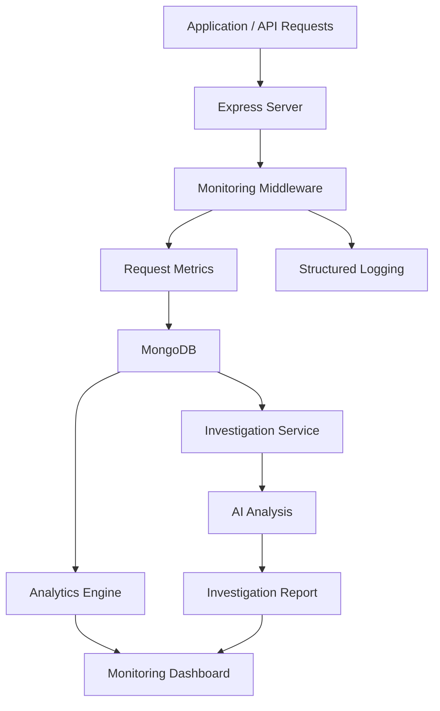

# 🚀 DevPilot
### AI-Powered API Monitoring & Investigation Platform

**DevPilot** is an API monitoring and investigation platform designed to help developers understand application health, identify recurring server errors, analyze API performance, and investigate backend issues.

It combines API observability, performance analytics, and AI-assisted investigation to turn raw application data into actionable debugging insights.

---

## ✨ Features

### 📡 API Monitoring
- Monitor backend service health.
- Track incoming API requests.
- Capture request failures and server errors.
- Monitor API response times and request behavior.

### 📊 Performance Analytics
- Calculate total API requests.
- Track failed requests and server errors.
- Calculate API error rates.
- Measure average response latency.
- Store monitoring data for analysis.

### 🤖 AI-Powered Investigation
- Investigate specific API endpoints using natural-language queries.
- Analyze recurring server errors.
- Calculate and interpret endpoint error rates.
- Generate investigation reports with potential debugging recommendations.
- Correlate deployment activity with application errors to support troubleshooting.

### 🔍 Backend Engineering
- Middleware-based request instrumentation.
- Structured request logging.
- Input validation using Zod.
- MongoDB integration for persistent monitoring data.
- TypeScript-based backend architecture.

### 🔌 MCP Integration
- Includes a Model Context Protocol (MCP) server entry point.
- Designed to support integration with MCP-compatible AI tools.

---

## 🛠️ Tech Stack

| Category | Technologies |
|---|---|
| Backend | Node.js, Express.js |
| Language | TypeScript, JavaScript |
| Database | MongoDB, Mongoose |
| Validation | Zod |
| AI Integration | OpenAI SDK |
| Logging | Pino, Pino HTTP |
| Security | Helmet, CORS |
| Frontend | React, TypeScript |
| Integration | Model Context Protocol (MCP) |
| Development | Git, GitHub, Postman |

---

## 🏗️ Architecture



---

## 📈 Monitoring Metrics

DevPilot tracks important API performance indicators.

| Metric | Description |
|---|---|
| Total Requests | Total API requests received |
| Failed Requests | Number of unsuccessful requests |
| Server Errors | Number of HTTP 5xx errors |
| Error Rate | Percentage of failed requests |
| Average Latency | Average API response time in milliseconds |

### Example Metrics

```json
{
  "success": true,
  "metrics": {
    "totalRequests": 53,
    "failedRequests": 13,
    "serverErrors": 10,
    "errorRate": 24.53,
    "averageLatencyMs": 1740.3
  }
}
```

---

## 🔍 API Investigation

DevPilot provides an investigation workflow for analyzing backend issues.

### Example Request

```bash
curl -X POST http://localhost:3000/api/investigate \
-H "Content-Type: application/json" \
-d '{
  "question": "Investigate the /payments endpoint. Find recent server errors, calculate the error rate, identify recurring errors, and suggest next debugging steps."
}'
```

The investigation workflow is designed to help developers:

1. Examine endpoint-level errors.
2. Identify recurring failure patterns.
3. Calculate error rates.
4. Analyze application performance.
5. Review deployment-related correlations.
6. Generate actionable debugging recommendations.

---

## 📁 Project Structure

```text
devpilot/
│
├── client/                 # Frontend application
│
├── src/
│   ├── config/             # Application configuration
│   ├── models/             # MongoDB models
│   ├── routes/             # API routes
│   ├── middleware/         # Request monitoring middleware
│   ├── controllers/        # Request handling logic
│   ├── mcp/                # MCP server integration
│   └── server.ts           # Backend entry point
│
├── docs/                   # Project documentation
├── .env                    # Environment configuration
├── .gitignore
├── package.json
├── package-lock.json
└── tsconfig.json
```

---

## ⚙️ Getting Started

### Prerequisites

- Node.js
- npm
- MongoDB instance
- OpenAI API key for AI-powered investigation

### 1. Clone the repository

```bash
git clone https://github.com/echosweta/devpilot.git

cd devpilot
```

### 2. Install dependencies

```bash
npm install
```

### 3. Configure environment variables

Create a `.env` file in the project root.

```env
PORT=3000
MONGODB_URI=your_mongodb_connection_string
OPENAI_API_KEY=your_openai_api_key
```

Never commit your actual API keys or database credentials.

### 4. Start the backend

```bash
npm run dev
```

The backend development server runs on the configured port (default: 3000).

### 5. Build for production

```bash
npm run build
```

Start the production server:

```bash
npm start
```

### 6. Start the MCP server

```bash
npm run mcp
```

---

## ❤️ API Health Check

**Endpoint**

```http
GET http://localhost:3000/health
```

**Example Response**

```json
{
  "status": "healthy",
  "service": "DevPilot API"
}
```

---

## 🗺️ Roadmap

- [x] Express + TypeScript backend
- [x] MongoDB integration
- [x] API health check
- [x] Request metrics and analytics
- [x] API error monitoring
- [x] AI-assisted investigation workflow
- [x] Deployment correlation analysis
- [x] Monitoring dashboard
- [x] MCP server entry point
- [ ] Advanced rate limiting
- [ ] Real-time alerting and notifications
- [ ] Docker-based deployment
- [ ] Authentication and API key management
- [ ] Advanced distributed monitoring

---

## 🎯 Project Goals

DevPilot explores practical backend engineering and observability concepts:

- Understanding API observability and monitoring.
- Implementing request lifecycle instrumentation.
- Building backend analytics and reporting systems.
- Investigating production-style application failures.
- Exploring AI-assisted debugging workflows.
- Understanding deployment and error correlation.
- Integrating backend services with AI tooling through MCP.

---

## 👩‍💻 Author

**Sweta Thakur**

Software Engineer | Backend Development | AI Engineering

- GitHub: [@echosweta](https://github.com/echosweta)
- Project: [DevPilot](https://github.com/echosweta/devpilot)

---

⭐ If you find DevPilot interesting, consider starring the repository!
